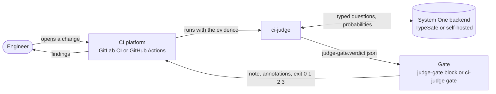
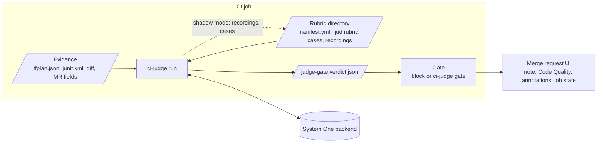
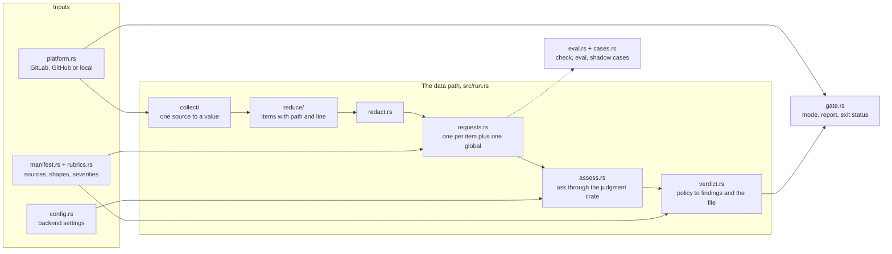
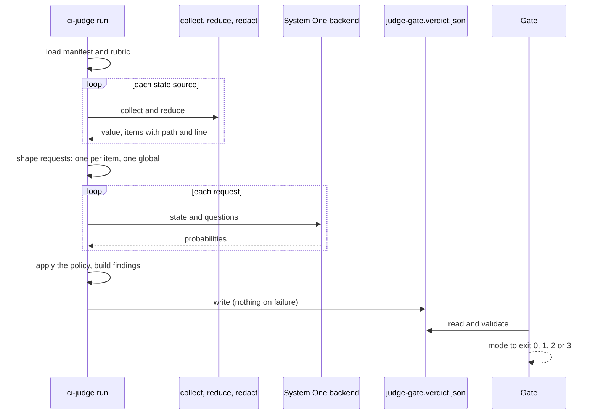

# Architecture

The C4 model of ci-judge in three levels, then one run as a sequence.
Each diagram shows one idea; the table under it carries the detail. Boxes
name files and crates so the diagrams can be checked against the code;
when they disagree, the code wins and this page is wrong.

## Level 1: context

ci-judge sits between a CI platform and a model. It reads a change's
evidence, asks a rubric, and writes one file. A gate reads that file and
decides.

| Element | What it is | Where |
|---|---|---|
| CI platform | The pipeline, its artifacts, the merge or pull request API | `src/platform.rs` |
| ci-judge | This binary: collect, redact, ask, write the verdict | `src/` |
| Gate | On GitLab a `judge-gate` block (shell and jq); on GitHub `ci-judge gate` or the composite action | `src/gate.rs`, `action.yml` |
| System One backend | Any server speaking `POST /v1/systemone`: the hosted API or a local model | `src/config.rs` |
| Reviewers and `jud` | Label shadow-mode cases and tune bars on the same `.jud` files, outside the pipeline | `.claude/skills/rubric/SKILL.md` |

## Level 2: containers

Inside one CI job, files are the seams: evidence in, the verdict file out,
the rubric directory shared with `jud`.

| Container | Role | Reads | Writes |
|---|---|---|---|
| `ci-judge run` | Collect, redact, shape one request per item plus one global, ask, apply the policy | evidence, rubric directory, `CI_*` or `GITHUB_*` variables | the verdict file; in shadow mode, recordings and the cases document |
| Verdict file | The contract between judging and deciding: `verdict`, `summary`, `route`, `findings`, then `ci_judge` | | |
| Gate | Validate the file, apply the mode, report, exit 0 pass, 1 blocked, 2 gate error, 3 warning | the verdict file, the override label | note or comment, Code Quality report, dotenv, route file, `GITHUB_OUTPUT` |
| Rubric directory | Bundled in the binary (`rubrics/`) or in the repository under review | | |

## Level 3: components

The modules of `src/`, in the order a run uses them. Left to right is the
data path; the boxes above feed it.

| Module | Does | Leans on |
|---|---|---|
| `main.rs` | The subcommands and their `CI_JUDGE_*`, `JUDGE_GATE_*` bindings | clap |
| `config.rs` | Backend settings as the `jud` command reads them: environment, `~/.config/jud/config.yaml`, defaults; `${VAR}` expansion | |
| `platform.rs` | Detects GitLab, GitHub or local; the change under review in one shape; failed job traces; note and comment upserts | reqwest |
| `manifest.rs`, `rubrics.rs` | The manifest beside a rubric and the bundled catalog | serde-saphyr |
| `collect/` | `artifact`, `diff`, `mr`, `file`, `env`, `joblog` | git, the platform API |
| `reduce/` | `tfplan`, `junit`, `diffhunks`, `json`, `text`, `lines`: raw output to a value and items that carry a path and a line | roxmltree |
| `redact.rs` | Secret patterns over every string before any network call | regex |
| `requests.rs` | One global request plus one per item, the byte budget, the item cap, finding templates | |
| `assess.rs` | `Client` (paced), `Replay`, `Recorder`; `Rubric::lower` per request; `.jud` recordings | judgment |
| `verdict.rs` | `Rubric::apply` verdicts to findings, the verdict file, the gate's validation in Rust | judgment, sha2 |
| `gate.rs` | Modes, override label, note or comment, annotations, Code Quality, dotenv, route | |
| `eval.rs`, `cases.rs` | `check`; `eval` over recordings (accuracy, Brier, calibration error, promotion bars); the shadow-mode cases writer | judgment |
| `error.rs` | Exit 0, 1, 2, 3 | |

## One run, step by step

Where the run stops early: a manifest the reader refuses or a model the
rubric was not tuned on is exit 2 before any call; a collector or a call
that fails is exit 1; both leave no verdict file, so the gate reports a
gate error and never a pass.

## Where to read next

| Question | File |
|---|---|
| What a manifest may say | `src/manifest.rs` |
| Why item requests carry no item source | `src/requests.rs` |
| What the verdict file holds and what the gate validates | `src/verdict.rs` |
| What each mode does on each platform | `src/gate.rs` |
| How a rubric is written and promoted | `.claude/skills/rubric/SKILL.md`, `rubrics/infra-plan/` |
| How the image is built | `Dockerfile`, `scripts/image-context.sh`, `CONTRIBUTING.md` |
