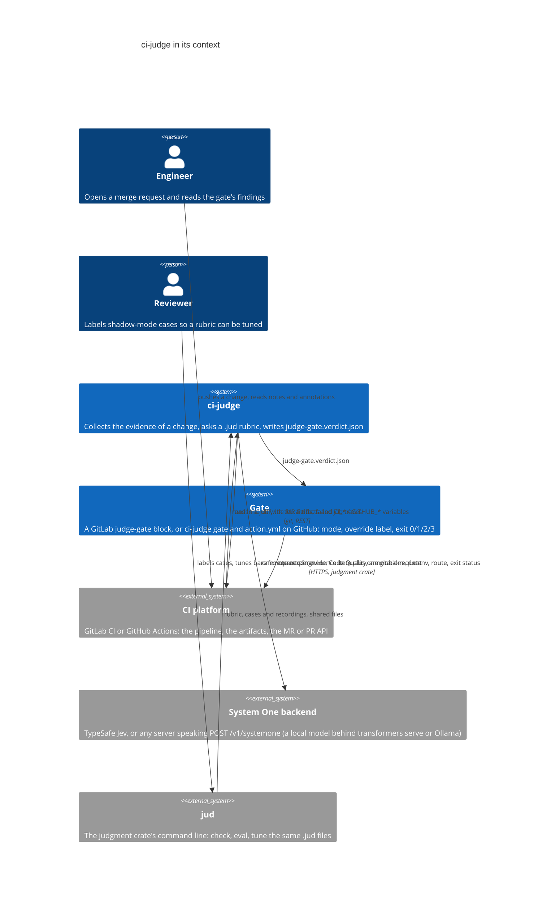
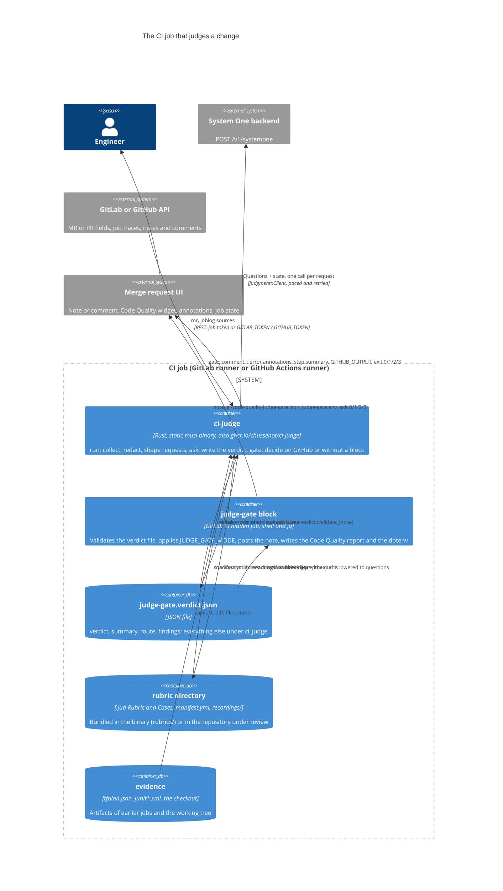
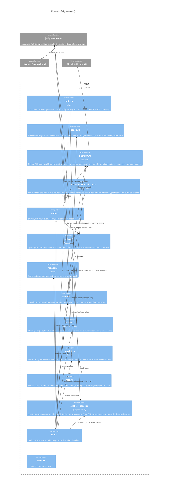
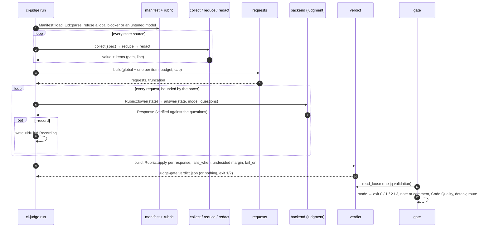

# Architecture

The C4 model of ci-judge, from the systems around it down to the modules
inside it. Every box names a file or a crate so the diagram can be checked
against the code; when they disagree, the code wins and this page is
wrong. Rendered by GitHub and by any Mermaid viewer.

## Level 1: system context

A merge request produces evidence. ci-judge turns that evidence into a
verdict file; a gate turns the file into a pipeline decision; a System One
backend is the only place a model runs.

## Level 2: containers

One static binary does the judging on both platforms. The decision is a
block on GitLab and a subcommand of the same binary on GitHub. Files on
disk are the seams: the verdict file between judging and deciding, the
`.jud` documents between this crate and `jud`.

## Level 3: components of the binary

`src/lib.rs` lists the modules; `src/main.rs` is the clap surface over
them. `run` is a straight line through the first row; `gate`, `check`
and `eval` are side doors into the same modules.

## Dynamic: one `ci-judge run`

## Where to read next

| Question | File |
|---|---|
| What a manifest may say | `src/manifest.rs` |
| What a request looks like and why item requests carry no item source | `src/requests.rs` |
| What the verdict file holds and what the gate validates | `src/verdict.rs` |
| What each mode does on each platform | `src/gate.rs` |
| How a rubric is written and promoted | `.claude/skills/rubric/SKILL.md`, `rubrics/infra-plan/` |
| How the image is built | `Dockerfile`, `scripts/image-context.sh`, `CONTRIBUTING.md` |
